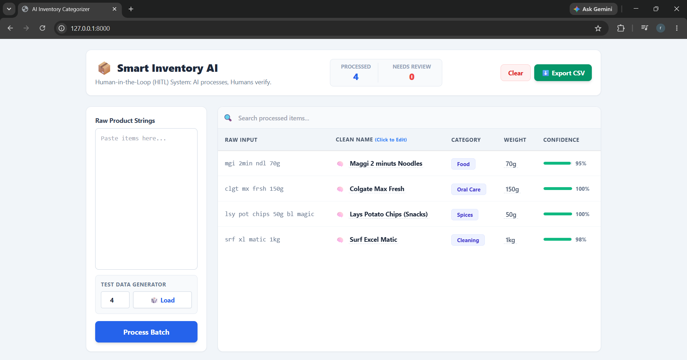

# Smart Inventory AI - HITL System 📦
Built for Hacktoberfest 2026

A local FastAPI application that utilizes open-weight AI to standardize messy shorthand Indian FMCG retail data into clean, exportable CSVs for stock valuation. 

## Features
- **Human-in-the-Loop (HITL):** Automatically flags ambiguous AI responses for manual review via an editable UI.
- **Explainable AI (XAI):** Uses Chain-of-Thought prompting to expose the AI's reasoning process via hover tooltips.
- **Bulk Processing:** Sequentially processes large datasets to prevent local hardware crashes.

## How to Run
1. Install requirements: `pip install fastapi[standard] pydantic ollama`
2. Start local AI model: `ollama pull llama3.2:1b`
3. Run the server: `fastapi dev main.py`
4. Open `http://localhost:8000` in your browser.

## Open-Source AI Usage
- **Model Used:** [Llama 3.2 (1B)](https://huggingface.co/meta-llama/Llama-3.2-1B) via Ollama locally.
- **Model License:** [Llama 3.2 Community License](https://github.com/meta-llama/llama-models/blob/main/models/llama3_2/LICENSE)
- **Role of AI:** The model acts as a context-aware data extraction engine, identifying Indian grocery brands from raw shorthand abbreviations and sorting them into standardized categories.

## 📸 Demo / Screenshot

## 👨‍💻 Built By
- Rahul Jain - [@Rahuljain6351](https://github.com/Rahuljain6351)